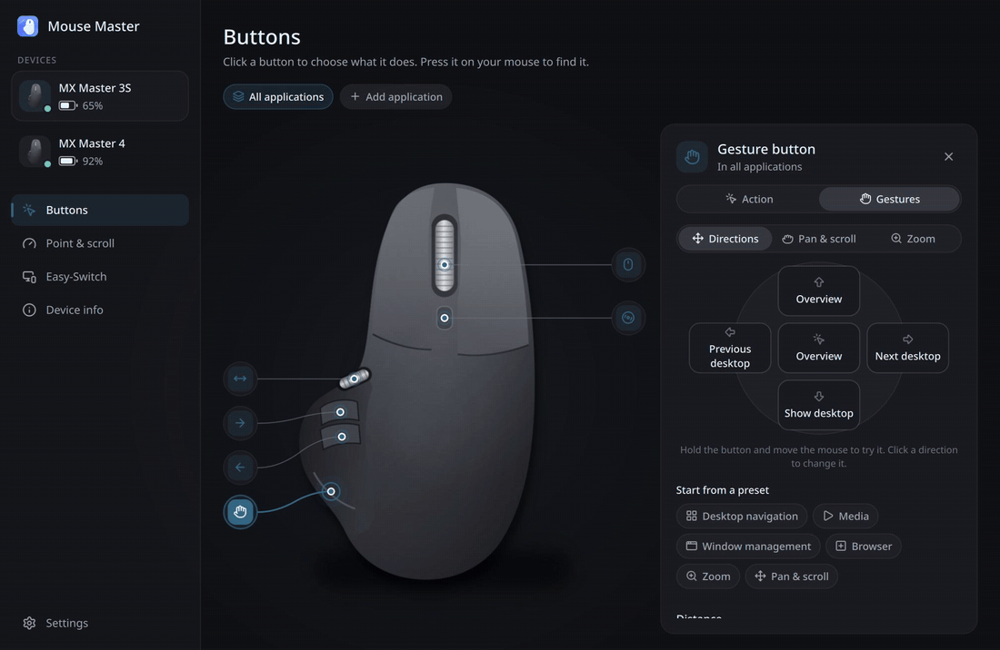
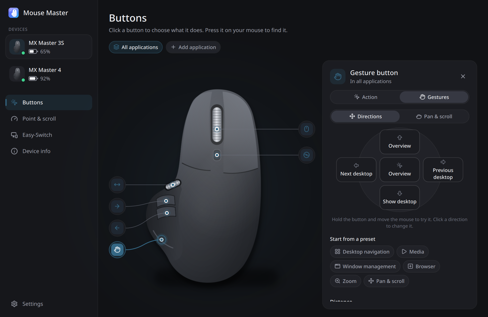
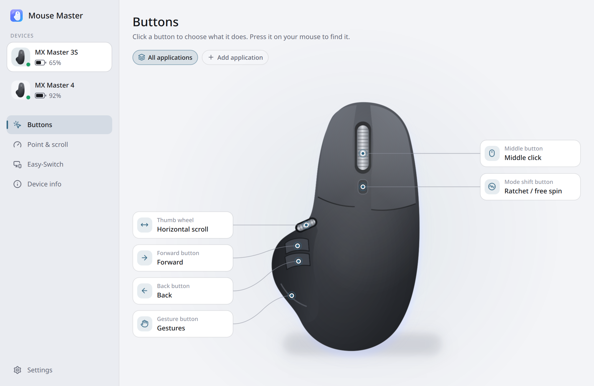
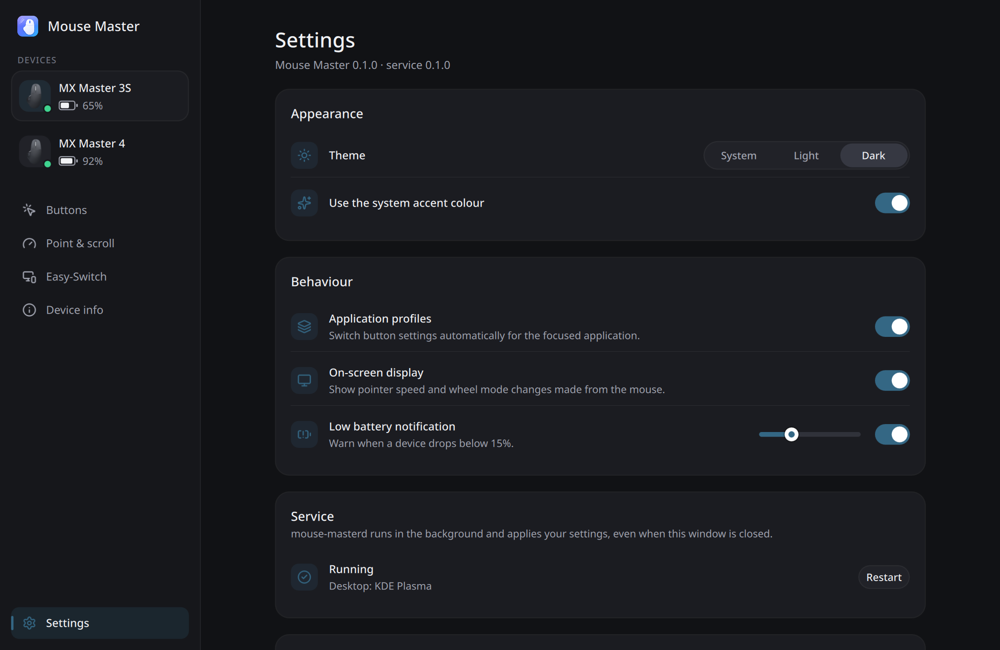
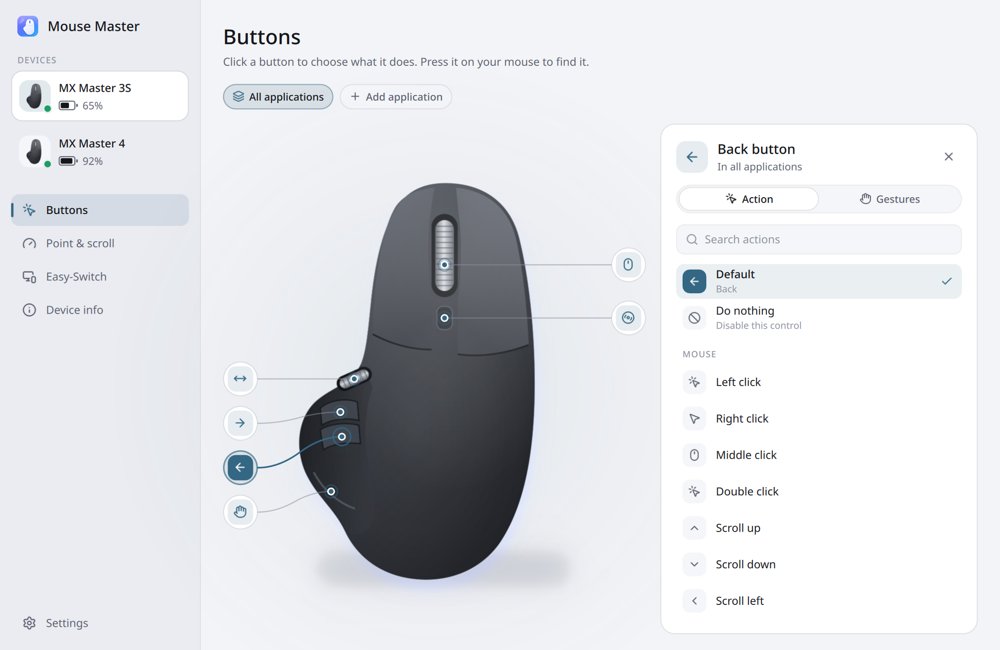
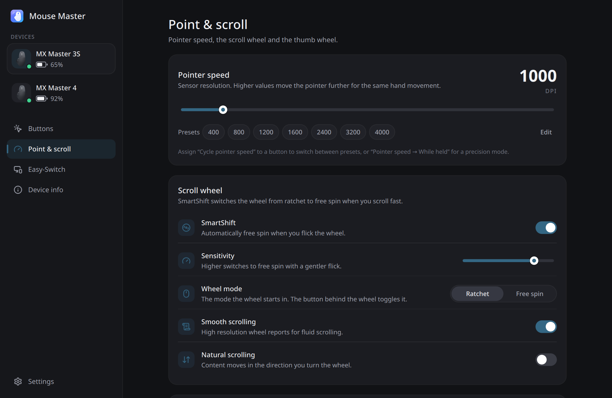
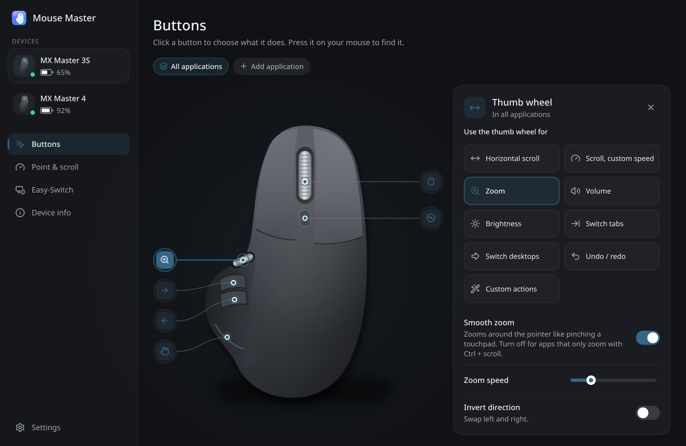
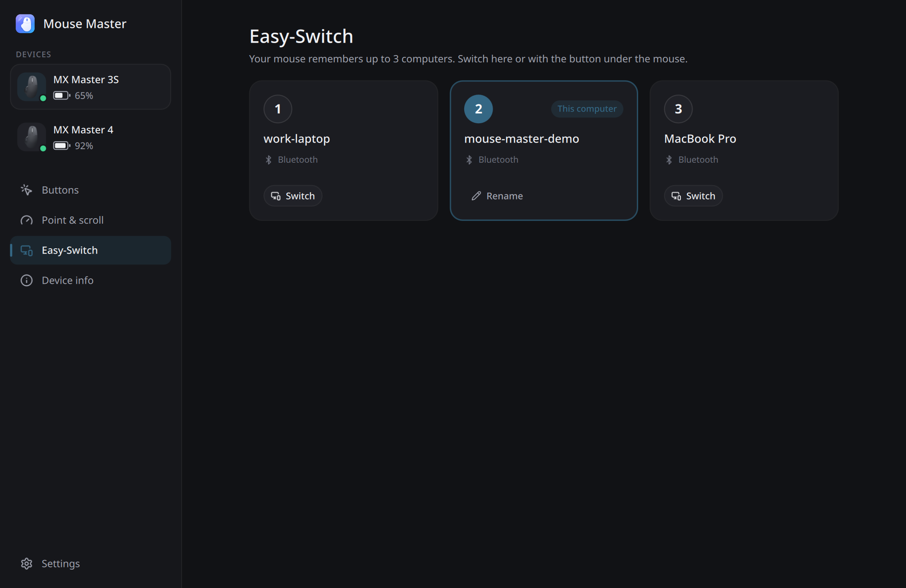
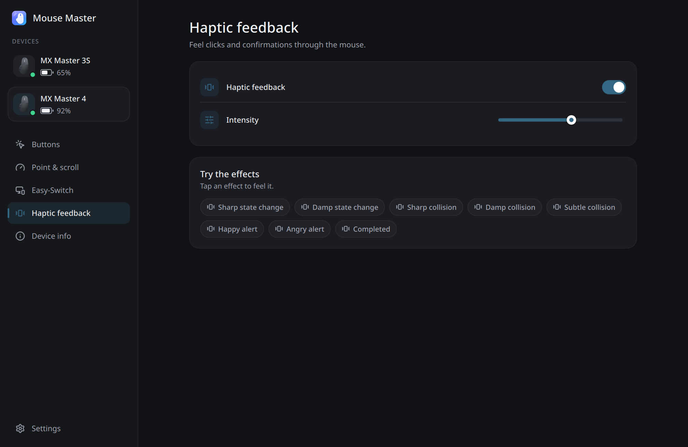

<div align="center">


# Mouse Master

**Everything your Logitech mouse can do — on Linux, on Wayland.**

Remap every button, hold and move for gestures, tune SmartShift and the thumb wheel,<br>
and give every application its own setup. Native on KDE Plasma, Hyprland, Sway and GNOME.

[](https://github.com/burakgon/mouse-master/actions/workflows/ci.yml)
[](LICENSE)




</div>

---

## Why

Logitech's Options+ never came to Linux. The existing tools are great at what they do —
Solaar for device settings, logiops for a config-file daemon — but none of them gives you
the whole experience: a polished app where you click a button on a picture of your mouse,
pick what it should do, and it just works, including gestures and per-application settings,
on a modern Wayland desktop.

Mouse Master is that app.

## Highlights

- **Every button, any action.** Built-in actions (overview, desktops, media, windows, tabs,
  zoom, screenshots…), keyboard shortcuts recorded with one press, mouse buttons, commands,
  apps, websites and files, pointer speed and Easy-Switch. Keys are *held* while you hold the
  button, so modifier combos and drag-and-drop work.
- **Mouse gestures on any capable button.** Hold the gesture button (or the middle, back,
  forward or mode shift button) and move: up, down, left, right, or just click. Presets for
  desktop navigation, media, windows, the browser and zoom; repeat while moving for volume and
  zoom; or **pan mode** — move the mouse to scroll in any direction.
- **Per-application profiles.** Customize buttons, gestures, the thumb wheel and even pointer
  speed for a single app. Switching is automatic and instant on **KDE Plasma** (KWin),
  **Hyprland** and **Sway**.
- **Thumb wheel superpowers.** Horizontal scrolling at your speed, or zoom, volume, brightness,
  tabs, desktops, undo/redo — or any two actions of your choice. Tap the wheel for one more.
- **Pointer & scroll.** DPI with presets, a cycle action and a hold-for-precision mode.
  SmartShift on/off and sensitivity, ratchet or free spin, torque (MX Master 4), smooth
  high-resolution scrolling and natural scrolling, all in the device itself.
- **Live.** Press a button on the mouse and it lights up in the app. Hold the gesture button
  and watch your gesture being drawn.
- **Easy-Switch, battery and haptics.** See and rename the computers your mouse is paired
  with, switch to another one, get a notification when the battery runs low, and tune the
  MX Master 4's haptic feedback.
- **Bluetooth, Bolt, Unifying and Lightspeed.** Settings follow the device, whichever way
  it is connected, and are applied again whenever it wakes up or reconnects.
- **Light and polite.** A Rust service that uses about **9 MB of memory** and no CPU while
  idle, a Qt 6 app you only open to change things, a D-Bus API and a CLI. It never changes a
  setting you did not touch, and puts every button back to normal when it stops.

<table>
  <tr>
    <td></td>
    <td></td>
  </tr>
  <tr>
    <td></td>
    <td></td>
  </tr>
  <tr>
    <td></td>
    <td></td>
  </tr>
  <tr>
    <td></td>
    <td></td>
  </tr>
</table>

## Install

### Arch Linux and derivatives (AUR)

```sh
yay -S mouse-master-git          # or paru, or makepkg -si in packaging/arch
systemctl --user enable --now mouse-master.service
```

### From source (any distribution)

You need Rust (1.85+), CMake, a C++ compiler and Qt 6.5 or newer:

| Distribution | Packages |
| --- | --- |
| Arch, CachyOS, Manjaro | `sudo pacman -S --needed rust cmake qt6-base qt6-declarative qt6-svg qt6-wayland` |
| Fedora | `sudo dnf install cargo cmake gcc-c++ qt6-qtbase-devel qt6-qtdeclarative-devel qt6-qtsvg-devel systemd-devel` |
| Debian 13, Ubuntu 24.10+ | `sudo apt install cargo cmake g++ libudev-dev qt6-base-dev qt6-declarative-dev qt6-svg-dev qt6-wayland qml6-module-qtquick-controls qml6-module-qtquick-layouts qml6-module-qtquick-shapes qml6-module-qtquick-effects qml6-module-qtquick-dialogs qml6-module-qtcore` |
| openSUSE Tumbleweed | `sudo zypper install cargo cmake gcc-c++ qt6-base-devel qt6-declarative-devel qt6-svg-devel systemd-devel` |

Then:

```sh
git clone https://github.com/burakgon/mouse-master
cd mouse-master
./scripts/install.sh            # installs to /usr/local, sets up device access and the service
```

`./scripts/install.sh --uninstall` removes it again (your settings stay in `~/.config/mouse-master`).

> [!NOTE]
> Mouse Master needs access to your Logitech devices and to `/dev/uinput`. The installer adds a
> udev rule that grants both to the user sitting at the computer — no root daemon, no `input`
> group. If you install another way, the app offers to set this up for you.

### Hyprland, Sway and other compositors

The service is a systemd user unit started at login (`default.target`), so it works without a
systemd-managed session. If your setup does not use systemd at all, start it yourself:

```ini
# ~/.config/hypr/hyprland.conf
exec-once = mouse-masterd
```

## Desktop support

| | KDE Plasma | Hyprland | Sway | GNOME | X11 |
| --- | :---: | :---: | :---: | :---: | :---: |
| Buttons, gestures, thumb wheel, keys, scrolling | ✅ | ✅ | ✅ | ✅ | ✅ |
| Desktop actions (overview, desktops, windows) | ✅ native | ✅ dispatchers | ✅ | ✅ shortcuts | ⚠️ some |
| Per-application profiles | ✅ | ✅ | ✅ | — | — |
| On-screen display for DPI and wheel mode | ✅ Plasma OSD | notification | notification | notification | notification |

Desktop actions use each desktop's own mechanism: KWin's global shortcuts on Plasma, IPC
dispatchers on Hyprland (Overview uses the `hyprexpo` plugin when present), `swaymsg` on Sway.

## Devices

Mouse Master speaks Logitech's HID++ 2.0 protocol and discovers what each device can do, so it
works with far more mice than it has artwork for.

| Device | Status |
| --- | --- |
| MX Master 3S | ✅ tested (Bluetooth) |
| MX Master 4 | ✅ simulated; haptics and SmartShift torque supported |
| MX Master 2S, MX Master 3 / 3 for Mac / 3S for Mac | expected to work — same features as the 3S |
| MX Anywhere 2S / 3 / 3S, MX Vertical, MX Ergo, Lift, M720, M590, Signature M650 | expected to work |
| G series over Lightspeed or USB | DPI, report rate and onboard memory; buttons where the mouse allows remapping |
| Bolt, Unifying, Lightspeed and Nano receivers | ✅ (receiver handling is covered by the test suite) |

Got one of these? Run `mouse-masterctl info` and [let us know](https://github.com/burakgon/mouse-master/issues/new?template=device-report.yml)
how it went — it helps others and lets us add artwork for your mouse.

## Command line

```console
$ mouse-masterctl list
● MX Master 3S             b034-5C8F7AF8    battery 65%

$ mouse-masterctl set dpi=1600 smartshift=true smartshift_threshold=12
$ mouse-masterctl bind back copy                   # a built-in action
$ mouse-masterctl bind forward '{"type":"keys","keys":["KEY_LEFTCTRL","KEY_T"]}'
$ mouse-masterctl bind gesture gestures            # gestures with the default set
$ mouse-masterctl actions                          # every built-in action on this desktop
$ mouse-masterctl monitor                          # watch buttons, gestures and focus changes
```

## Configuration

Settings live in `~/.config/mouse-master/config.toml`. The app writes it for you, but it is
meant to be readable and editable (stop the service while you edit it):

```toml
[devices."b034-5C8F7AF8"]
name = "MX Master 3S"

[devices."b034-5C8F7AF8".settings]
dpi = 1600
dpi_presets = [800, 1600, 3200]
smartshift = true
smartshift_threshold = 12

[devices."b034-5C8F7AF8".bindings.buttons.gesture]
type = "gestures"
up = { type = "builtin", id = "overview" }
down = { type = "builtin", id = "show-desktop" }
left = { type = "builtin", id = "workspace-right" }
right = { type = "builtin", id = "workspace-left" }
click = { type = "builtin", id = "overview" }

[devices."b034-5C8F7AF8".bindings.buttons.back]
type = "keys"
keys = ["KEY_LEFTCTRL", "KEY_Z"]

[[devices."b034-5C8F7AF8".profiles]]
id = "p1"
name = "Firefox"
apps = ["firefox", "org.mozilla.firefox"]
bindings.buttons.forward = { type = "builtin", id = "reopen-tab" }
```

See [docs/configuration.md](docs/configuration.md) for every option.

## How it works

```
 Logitech mouse ──HID++ over hidraw──▶ mouse-masterd ──uinput──▶ your compositor
 (Bluetooth / receiver)                 │  ▲     │
                                        │  │     └── KWin / Hyprland / Sway: focused app,
                         D-Bus (session)│  │         desktop actions
                                        ▼  │
                           Mouse Master app, mouse-masterctl
```

The service diverts only the buttons you assign, so everything else keeps working natively,
and it hands the buttons back when it stops. Gestures use the mouse's own raw motion reports
while the button is held, so the pointer stays still. Actions are performed through uinput
(keys, buttons, high-resolution scrolling) or the desktop's own API.

More in [docs/architecture.md](docs/architecture.md).

## Compared with

| | Mouse Master | Solaar | logiops | Options+ |
| --- | :---: | :---: | :---: | :---: |
| Linux | ✅ | ✅ | ✅ | — |
| Graphical app | ✅ Qt 6 | ✅ GTK 3 | — | ✅ |
| Click-a-button remapping on device artwork | ✅ | — | — | ✅ |
| Mouse gestures | ✅ any capable button | via rules | ✅ | ✅ gesture button |
| Pan (drag to scroll) | ✅ | — | ✅ via axes | ✅ |
| Per-application profiles | ✅ automatic on Wayland | via rules (X11, GNOME) | — | ✅ |
| Thumb wheel actions + tap | ✅ | via rules | ✅ | ✅ |
| Receiver pairing | planned | ✅ | — | ✅ |
| Keyboards and lighting | planned | ✅ | partial | ✅ |

Solaar and logiops both divert buttons too: run only one of these tools at a time.

## Troubleshooting

- **"Allow access to your devices" in the app** — the udev rule is missing. Click *Grant
  access* (asks for your password once), or install it by hand:
  `sudo install -m644 data/udev/70-mouse-master.rules /etc/udev/rules.d/ && sudo udevadm control --reload && sudo udevadm trigger`.
- **A button does nothing after a crash** — the service restarts automatically and fixes it;
  turning the mouse off and on also restores its native behaviour.
- **Scrolling suddenly too fast or slow after toggling smooth scrolling** — older kernels do
  not notice the change. Toggle it back or reconnect the mouse.
- **Logs** — `journalctl --user -u mouse-master -f`, or run `mouse-masterd -v` in a terminal.
- **Try it without hardware** — `mouse-masterd --demo` runs on simulated devices.

## Development

```sh
cargo test --workspace                      # protocol, gesture engine and end-to-end tests
cargo run -p mouse-masterd -- --demo -v     # the service on simulated devices
cmake -B build -DBUILD_SERVICE=OFF && cmake --build build && ./build/app/mouse-master
```

- `crates/hidpp` — async HID++ 1.0/2.0 for Linux hidraw, plus a device simulator
- `crates/daemon` — `mouse-masterd`: device actors, gestures, actions, profiles, D-Bus API
- `crates/ctl` — `mouse-masterctl`
- `app` — the Qt 6 / QML app

Contributions are very welcome — see [CONTRIBUTING.md](CONTRIBUTING.md). Device reports,
artwork for more mice and translations are especially appreciated.

## Acknowledgements

Mouse Master stands on the shoulders of the people who documented HID++: the
[Solaar](https://github.com/pwr-Solaar/Solaar) and [logiops](https://github.com/PixlOne/logiops)
projects, and Logitech's published [HID++ documentation](https://github.com/Logitech/cpg-docs).
Icons by [Lucide](https://lucide.dev) (ISC).

## License

GPL-3.0-or-later. See [LICENSE](LICENSE).

Logitech, Logi, MX Master, MX Anywhere, Bolt, Unifying, Lightspeed, Easy-Switch and SmartShift
are trademarks of Logitech. Mouse Master is an independent project and is not affiliated with,
endorsed by, or sponsored by Logitech.
